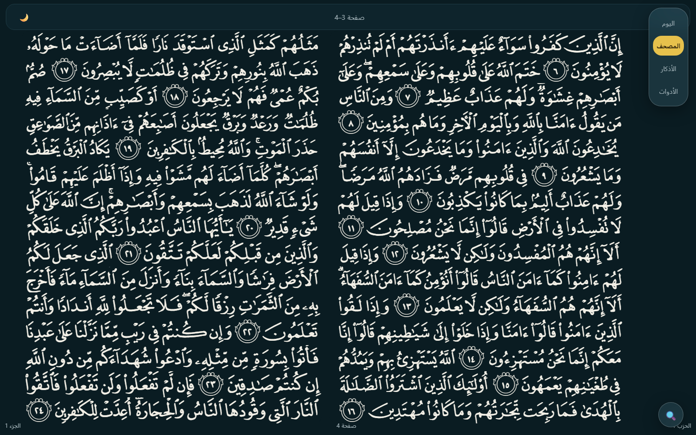

<div align="center">

[English](README.md) · **العربية**


# إسلامي · Islami (Sadaqa Jaria)

رفيق إسلامي مجاني ومفتوح المصدر يعمل دون اتصال بالكامل: مصحف عثماني كامل (604 صفحات) مع التفسير، مواقيت صلاة دقيقة، أذكار اليوم، ومخطِّط ختمة. لا حسابات، لا إعلانات، لا تتبّع — بياناتك تبقى على جهازك.

<br />



<br />

[](LICENSE)
[](https://github.com/ixboss/sadaqa-jaria/actions/workflows/ci.yml)
[](https://github.com/ixboss/sadaqa-jaria/releases/latest)

<br />

[**افتح التطبيق على الويب**](https://ixboss.github.io/sadaqa-jaria/) · [**التنزيل**](https://github.com/ixboss/sadaqa-jaria/releases/latest) · [**إبلاغ عن مشكلة**](https://github.com/ixboss/sadaqa-jaria/issues)

</div>

---

## صدقة جارية

هذا المشروع مُنالٌ نيةً للصدقة الجارية. قال النبي ﷺ:

> «إِذَا مَاتَ الإِنْسَانُ انْقَطَعَ عَنْهُ عَمَلُهُ إِلاَّ مِنْ ثَلاَثَةٍ: صَدَقَةٍ جَارِيَةٍ، وَعِلْمٍ يُنْتَفَعُ بِهِ، وَوَلَدٍ صَالِحٍ يَدْعُو لَهُ»

وهو متاح للجميع بلا مقابل، بنيةٍ واحدة: أن يكون نافعًا مستمرًا. لا نزعم أجرًا ولا نضمنه — فقط أن يبقى هادئًا، صحيحًا، محفوظ الخصوصية، ومفيدًا.

---

## ماذا يقدّم؟

- **المصحف المدني الكامل (604 صفحات)** بصفحة تقليدية: تقلّب الصفحات بالسحب أو النقر، تكبير، علامات مرجعية، وحفظ آخر موضع وصلت إليه. اضغط على أي آية لتفتح **التفسير الميسّر** دون اتصال.
- **مواقيت الصلاة وأوقات السنة** تُحسب محليًا بالكامل، وبنفس المعادلات في كل النسخ — محركات JS وSwift وKotlin مفحوصة التطابق بعضها مع بعض، فتعطي كل المنصات النتيجة نفسها. مع إشعارات الأذان وعدّاد في شريط النظام على سطح المكتب.
- **أدوات العبادة:** مجمع الحصن المسلم والأذكار والرقية مع البحث، مسبحة إلكترونية، مخطِّط ختمة، وبطاقة الورد اليومي.
- **الخصوصية أصلًا في التصميم:** كل شيء يعمل محليًا — بلا حساب، بلا إعلانات، بلا تحليلات، ولا اتصال بالشبكة بعد أول تحميل.
- **بطاقات آيات قابلة للمشاركة** بتصميم ذهبي أو زمردي.

---

## التثبيت

كل الإصدارات في [صفحة الإصدارات](https://github.com/ixboss/sadaqa-jaria/releases/latest). أسماء الملفات في كل إصدار:

| المنصة | الملف |
|---|---|
| الويب (PWA) | `sadaqa-jaria-<tag>-web.zip` |
| iOS | `SadaqaJaria-<tag>-unsigned.ipa` |
| أندرويد | `sadaqa-jaria-<tag>-android.apk` |
| ويندوز | `SadaqaJaria-Setup-<version>.exe` |
| macOS (Apple Silicon) | `SadaqaJaria-<version>-arm64.dmg` + نسخة `.zip` محمولة |
| لينكس | `SadaqaJaria-<version>-x86_64.AppImage` و`SadaqaJaria-<version>-amd64.deb` |

> مثبّتات سطح المكتب تحمل رقم إصدار التطبيق لا رقم الوسم (في v1.0.0 الاثنان متطابقان: `1.0.0` / `v1.0.0`).

### الويب (PWA) — لا تثبيت أصلًا

افتح [ixboss.github.io/sadaqa-jaria](https://ixboss.github.io/sadaqa-jaria/). بعد أول تحميل يعمل دون اتصال تمامًا. ولتثبيته كتطبيق: **Chrome / Edge** ← «Install app»؛ **آيفون / آيباد (Safari)** ← مشاركة ← «إضافة إلى الشاشة الرئيسية»؛ **أندرويد (Chrome)** ← القائمة ← «إضافة إلى الشاشة الرئيسية».

### أندرويد

نزّل `sadaqa-jaria-<tag>-android.apk` من [الإصدارات](https://github.com/ixboss/sadaqa-jaria/releases/latest) وافتحه على الهاتف. سيطلب أندرويد السماح بالتثبيت من المتصفح مرة واحدة — اسمح وتابع. الملف مبني بنسخة debug موقّعة للتثبيت المباشر.

### iOS (آيفون / آيباد)

ملف `.ipa` المنشور غير موقّع — توقّعه بنفسك بحساب Apple ID عند التثبيت الجانبي، وهذا مجاني ولا يحتاج حساب مطوّر مدفوع.

#### على الجهاز مباشرةً وبلا حاسوب — SideInstaller (موصى به)

[SideInstaller](https://sideinstaller.net/) مشروع مفتوح المصدر مستقل يوقّع ملفات `.ipa` ويثبّتها من داخل الهاتف نفسه.

> ⚠️ استخدم **المصادر الرسمية فقط**: [sideinstaller.net](https://sideinstaller.net/) أو [github.com/FrizzleM/SideInstaller](https://github.com/FrizzleM/SideInstaller). المواقع المشابهة (وثّق المشروع نفسه أن `sideinstaller.com` موقع مزيّف وخطِر) والنسخ المُعاد توقيعها غير آمنة — لا تُدخل حساب Apple ID في أي جهة أخرى.

- **iOS 27 وما بعده:** كل شيء يتم على الهاتف من البداية إلى النهاية.
- **iOS 17.4 – 26.7:** تنشئ مرة واحدة «ملف اقتران» (pairing file) على أي حاسوب وتستورده، وبعدها يصبح كل شيء على الجهاز. (النسخ 17.4–26.3 تحتاج ملف اقتران عاديًا، والنسخ 26.4–26.7 تحتاج ملف «الاقتران البعيد». موقع SideInstaller يشرح الحالتين خطوة بخطوة.)
- ما قبل iOS 17.4: غير مدعوم.

1. على الآيفون، ثبّت **SideInstaller** من [sideinstaller.net](https://sideinstaller.net/) — وعلى iOS 27+ يثبّته سير *siboot* من الهاتف نفسه (يكفي Wi-Fi وحساب Apple وتفعيل وضع المطوّر) — ثم ثبّت **LocalDevVPN** من متجر App Store.
2. بعدها إما:
   - **بنقرة واحدة:** افتح [رابط التثبيت المباشر](https://sideinstaller.net/open.html?url=https%3A%2F%2Fgithub.com%2Fixboss%2Fsadaqa-jaria%2Freleases%2Fdownload%2Fv1.0.0%2FSadaqaJaria-v1.0.0-unsigned.ipa) على الهاتف — يمرر ملف الإصدار v1.0.0 إلى SideInstaller مباشرة. وعند صدور إصدار أحدث، انسخ رابط ملف `.ipa` من صفحة ذلك الإصدار وألصقه في خانة **Custom .ipa** داخل SideInstaller (يقبل رابطًا أو ملفًا من تطبيق «الملفات»).
   - أو نزّل ملف `.ipa` من [الإصدارات](https://github.com/ixboss/sadaqa-jaria/releases/latest) واختره من **Custom .ipa**.
3. اتبع خطوات التطبيق: وصّل **LocalDevVPN**، وسجّل الدخول بحساب Apple ID (لا يترك الجهاز أبدًا — يُستخدم للتوقيع محليًا فقط)، ثم اكتب رمز الاقتران الظاهر في نافذة الإعدادات، وانتظر اكتمال التثبيت.
4. على حساب **مجاني**، لا يمكن توقيع أكثر من 3 تطبيقات. ثبّت **SideStore** (يقدّمه SideInstaller أثناء الإعداد) وشغّل التطبيق داخل **LiveContainer** حتى لا يُحتسب ضمن ذلك الحد.

#### عبر حاسوب — بدائل

- **SideStore / AltStore:** ثبّت التطبيق المرافق على الحاسوب، وصّل الهاتف، وثبّت الملف. الحساب المجاني يحتاج إعادة توقيع كل 7 أيام، وSideStore يجددها تلقائيًا عبر Wi-Fi بعد ذلك.
- **Sideloadly:** وصّل الهاتف، أفلِت ملف `.ipa` في التطبيق، وقّع بحسابك، وثبّت.
- **من المصدر:** أنشئ مشروع Xcode بواسطة XcodeGen وشغّل `apps/ios-native` على جهازك بفريق توقيع خاص بك — راجع [CONTRIBUTING.md](CONTRIBUTING.md).

### ويندوز / macOS / لينكس (Electron)

نزّل المثبّت المناسب لنظامك من [الإصدارات](https://github.com/ixboss/sadaqa-jaria/releases/latest) وشغّله.

- **ويندوز:** شغّل `SadaqaJaria-Setup-<version>.exe`. قد يظهر تحذير SmartScreen لأن النسخة غير موقّعة بشهادة — اختر *More info ← Run anyway*.
- **macOS (Apple Silicon فقط):** افتح ملف `.dmg` واسحب التطبيق إلى Applications. وإن منع Gatekeeper التشغيل أول مرة، نفّذ:

  ```bash
  xattr -dr com.apple.quarantine "/Applications/Sadaqa Jaria.app"
  ```

- **لينكس:** اجعل ملف AppImage قابلاً للتنفيذ (`chmod +x SadaqaJaria-*.AppImage`) وشغّله، أو ثبّت ملف `.deb` بمدير الحزم لديك.

---

## كيف مبني؟

| الطبقة | التنفيذ |
|---|---|
| **النواة المشتركة** | [`packages/core-data`](packages/core-data) — محركات حتمية (مواقيت الصلاة، الهجري، القبلة، البحث FTS5، صيغة النسخ الاحتياطي `.sadaqa`)، وفحوص تطابق على مستوى البايت تُبقي JS وSwift وKotlin متطابقة |
| **التخزين** | مخطط SQLite واحد (53 جدولًا) في كل المنصات: SQLite-WASM + OPFS على الويب، `better-sqlite3` على Electron، `GRDB` على iOS، و`androidx.sqlite` على أندرويد |
| **التصميم** | [`packages/design-tokens`](packages/design-tokens) — رموز Liquid Glass والاتجاه RTL المشتركة |
| **الويب وPWA** | [`apps/web-desktop`](apps/web-desktop) وتطبيق PWA في جذر المستودع (`index.html`، `sw.js`) |
| **سطح المكتب** | [`apps/electron`](apps/electron) — غلاف بلا خادم مع عدّاد في شريط النظام وإشعارات الأذان |
| **الجوال** | [`apps/ios-native`](apps/ios-native)‏ (SwiftUI + WidgetKit) و[`apps/android-native`](apps/android-native)‏ (Jetpack Compose + Glance) |

للبناء من المصدر — الأصول دون الاتصال، قواعد البيانات، ومشاريع الأنظمة الأصلية — راجع [CONTRIBUTING.md](CONTRIBUTING.md#development-commands-v2-workspace).

---

## الترخيص

منشور بموجب [رخصة MIT](LICENSE).

تغطي رخصة MIT **الشيفرة** أما نص القرآن والتفسير والتلاوات فمصدرها جهاتها الأصلية (AlQuran Cloud وQuran.com / QUL وEveryAyah) ولها شروطها الخاصة — احترمها، ولا تغيّر النص القرآني أبدًا.

---

<div align="center">

### الإهداء

بُني هذا المشروع بنية واحدة: أن ينفع، ويظل ينفع.

**إن نفعك، فادعُ لصانعه وكل من ساهم فيه.**

**صدقة جارية**

<sub>لا تنسونا من صالح دعائكم</sub>

</div>
