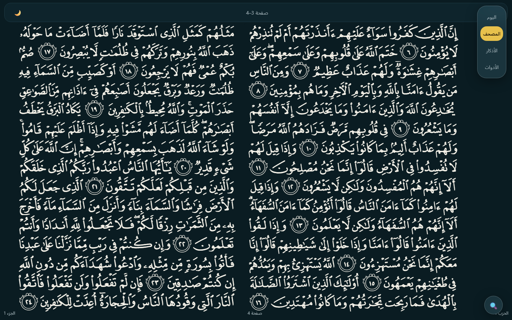

<div align="center">

**English** · [العربية](README.ar.md)


# إسلامي · Islami (Sadaqa Jaria)

A free, open-source, fully offline Islamic companion — a 604-page Uthmani Mushaf with tafsir, accurate prayer times, daily adhkar, and a khatmah planner. No accounts, no ads, no tracking: your data stays on your device.

<br />



<br />

<!-- launch-readiness:start:badges -->
[](LICENSE)
[](https://github.com/ixboss/sadaqa-jaria/actions/workflows/ci.yml)
[](https://github.com/ixboss/sadaqa-jaria/releases/latest)
<!-- launch-readiness:end:badges -->

<br />

[**Open the web app**](https://ixboss.github.io/sadaqa-jaria/) · [**Download**](https://github.com/ixboss/sadaqa-jaria/releases/latest) · [**Report an issue**](https://github.com/ixboss/sadaqa-jaria/issues)

</div>

---

## Sadaqah Jariyah

This project is offered as **صدقة جارية — sadaqah jariyah** (ongoing charity). The Prophet ﷺ said:

> «إِذَا مَاتَ الإِنْسَانُ انْقَطَعَ عَنْهُ عَمَلُهُ إِلاَّ مِنْ ثَلاَثَةٍ: صَدَقَةٍ جَارِيَةٍ، وَعِلْمٍ يُنْتَفَعُ بِهِ، وَوَلَدٍ صَالِحٍ يَدْعُو لَهُ»
>
> *"When a person dies, their deeds come to an end except three: an ongoing charity, beneficial knowledge, and a righteous child who prays for them."*

It's free for everyone, with one intention: to be of ongoing benefit. No reward is claimed or guaranteed — only that it stays calm, accurate, private, and useful.

---

## What's inside

- **The complete 604-page Madani Mushaf** as a page-turn reader: swipe or tap to turn, zoom, bookmark, and pick up where you stopped. Tap any ayah for the offline **Tafsir Al-Muyassar**.
- **Prayer times & sunnah windows** computed entirely offline, on the same math in every build — the JS, Swift, and Kotlin engines are verified against each other so all platforms answer identically. Adhan notifications and a tray countdown on desktop.
- **Worship tools:** the full Hisn al-Muslim adhkar & Ruqyah collection with search, a tasbih counter, a khatmah planner, and a daily wird card.
- **Private by construction:** everything runs locally. No account, no ads, no analytics, and no network calls after the first load.
- **Shareable ayah cards** — send a verse as a gold or emerald card.

---

## Installation

Everything ships on the [Releases page](https://github.com/ixboss/sadaqa-jaria/releases/latest). Release file names:

| Platform | File |
|---|---|
| Web (PWA) | `sadaqa-jaria-<tag>-web.zip` |
| iOS | `SadaqaJaria-<tag>-unsigned.ipa` |
| Android | `sadaqa-jaria-<tag>-android.apk` |
| Windows | `SadaqaJaria-Setup-<version>.exe` |
| macOS (Apple Silicon) | `SadaqaJaria-<version>-arm64.dmg` + portable `.zip` |
| Linux | `SadaqaJaria-<version>-x86_64.AppImage`, `SadaqaJaria-<version>-amd64.deb` |

> Desktop installers embed the app version rather than the tag (on v1.0.0 both are `1.0.0` / `v1.0.0`).

### Web (PWA) — nothing to install

Open [ixboss.github.io/sadaqa-jaria](https://ixboss.github.io/sadaqa-jaria/). After the first load it works completely offline. To keep it as an app: **Chrome / Edge** → "Install app"; **iPhone / iPad (Safari)** → Share → *Add to Home Screen*; **Android (Chrome)** → menu → *Add to Home screen*.

### Android

Download `sadaqa-jaria-<tag>-android.apk` from [Releases](https://github.com/ixboss/sadaqa-jaria/releases/latest) and open it on your phone. Android will ask you to allow installs from your browser once — allow it and continue. The APK is a debug-signed build meant to be installed directly.

### iOS (iPhone / iPad)

The `.ipa` we publish is unsigned — you sign it with your own Apple ID when sideloading. That's free and doesn't need a paid developer account.

#### On the device, with no computer — SideInstaller (recommended)

[SideInstaller](https://sideinstaller.net/) is a separate open-source project that signs and installs `.ipa` files entirely on the phone.

> ⚠️ Use **only** the official sources: [sideinstaller.net](https://sideinstaller.net/) or [github.com/FrizzleM/SideInstaller](https://github.com/FrizzleM/SideInstaller). Look-alike domains (its own README flags `sideinstaller.com` as a fake) and re-signed copies are unsafe — don't enter your Apple ID anywhere else.

- **iOS 27 and later:** everything runs on the phone, start to finish.
- **iOS 17.4 – 26.7:** you create a one-time *pairing file* on any computer and import it; after that, everything else happens on-device. (iOS 17.4–26.3 uses a standard pairing file; 26.4–26.7 needs the "remote pairing" kind. SideInstaller's site walks you through both.)
- Below iOS 17.4: not supported.

1. On the iPhone, install **SideInstaller** from [sideinstaller.net](https://sideinstaller.net/) — on iOS 27+ its *siboot* flow installs it from the phone itself (Wi-Fi, your Apple ID, and Developer Mode are all it needs) — then get **LocalDevVPN** from the App Store.
2. Then either:
   - **One tap:** open [our direct install link](https://sideinstaller.net/open.html?url=https%3A%2F%2Fgithub.com%2Fixboss%2Fsadaqa-jaria%2Freleases%2Fdownload%2Fv1.0.0%2FSadaqaJaria-v1.0.0-unsigned.ipa) on the phone — it hands the v1.0.0 `.ipa` straight to SideInstaller. When a newer release comes out, copy the `.ipa` link from that release's page and paste it into SideInstaller's **Custom .ipa** field instead (it accepts a URL or a file picked from the Files app).
   - Or download the `.ipa` from [Releases](https://github.com/ixboss/sadaqa-jaria/releases/latest) and pick it in **Custom .ipa**.
3. Follow the in-app steps: connect **LocalDevVPN**, sign in with your Apple ID (it never leaves the device — it's used only to sign the app locally), type the pairing code it shows into the prompt in Settings, and wait for the install to finish.
4. On a **free** Apple ID, you can only sign 3 apps. Install **SideStore** (SideInstaller offers it during setup) and run the app inside **LiveContainer** so it doesn't count against that limit.

#### With a computer — alternatives

- **SideStore / AltStore:** install the desktop companion, connect the phone, and install the `.ipa`. A free Apple ID needs re-signing every 7 days; SideStore can refresh on its own over Wi-Fi afterwards.
- **Sideloadly:** plug the phone in, drop the `.ipa` in, sign with your Apple ID, install.
- **From source:** generate the Xcode project with XcodeGen and run `apps/ios-native` on your device with your own signing team — see [CONTRIBUTING.md](CONTRIBUTING.md).

### Windows / macOS / Linux (Electron)

Download the installer for your OS from [Releases](https://github.com/ixboss/sadaqa-jaria/releases/latest) and run it.

- **Windows:** run `SadaqaJaria-Setup-<version>.exe`. SmartScreen may warn because the build isn't code-signed — choose *More info → Run anyway*.
- **macOS (Apple Silicon):** open the `.dmg` and drag the app to Applications. If Gatekeeper blocks the first launch, run:

  ```bash
  xattr -dr com.apple.quarantine "/Applications/Sadaqa Jaria.app"
  ```

- **Linux:** make the AppImage executable (`chmod +x SadaqaJaria-*.AppImage`) and run it, or install the `.deb` with your package manager.

---

## How it's built

| Layer | Implementation |
|---|---|
| **Shared core** | [`packages/core-data`](packages/core-data) — deterministic engines (prayer times, Hijri, Qibla, FTS5 search, `.sadaqa` backup codec); byte-level parity fixtures keep JS, Swift, and Kotlin in lockstep |
| **Storage** | one 53-table SQLite schema everywhere: SQLite-WASM + OPFS on Web, `better-sqlite3` on Electron, `GRDB` on iOS, `androidx.sqlite` on Android |
| **Design** | [`packages/design-tokens`](packages/design-tokens) — shared Liquid Glass & RTL tokens |
| **Web & PWA** | [`apps/web-desktop`](apps/web-desktop) & the root PWA (`index.html`, `sw.js`) |
| **Desktop** | [`apps/electron`](apps/electron) — zero-server shell with system tray countdown & Adhan notifications |
| **Mobile** | [`apps/ios-native`](apps/ios-native) (SwiftUI + WidgetKit) & [`apps/android-native`](apps/android-native) (Jetpack Compose + Glance) |

To build any of it from source — offline assets, databases, native projects — see [CONTRIBUTING.md](CONTRIBUTING.md#development-commands-v2-workspace).

---

## License

Released under the [MIT License](LICENSE).

The MIT license covers the **code**. The Quran text, tafsir, and recitations come from their respective sources (AlQuran Cloud, Quran.com / QUL, EveryAyah) and carry their own terms — please respect them, and never alter the sacred text.

---

<div align="center">

### Dedication

This project was built with one intention: to be of benefit, and to keep being of benefit.

**If it helped you, please remember its maker and everyone who contributed in your du'a.**

**صدقة جارية · Sadaqah Jariyah**

<sub>لا تنسونا من صالح دعائكم · Please remember us in your du'a</sub>

</div>
